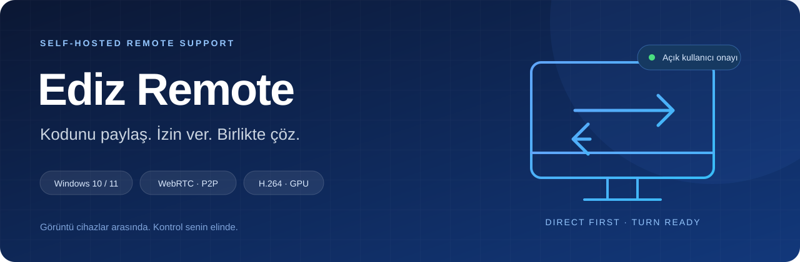
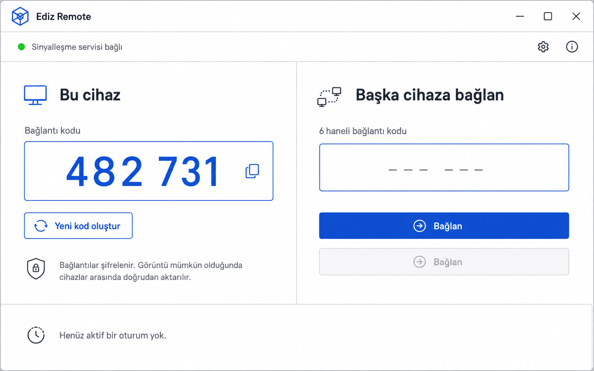
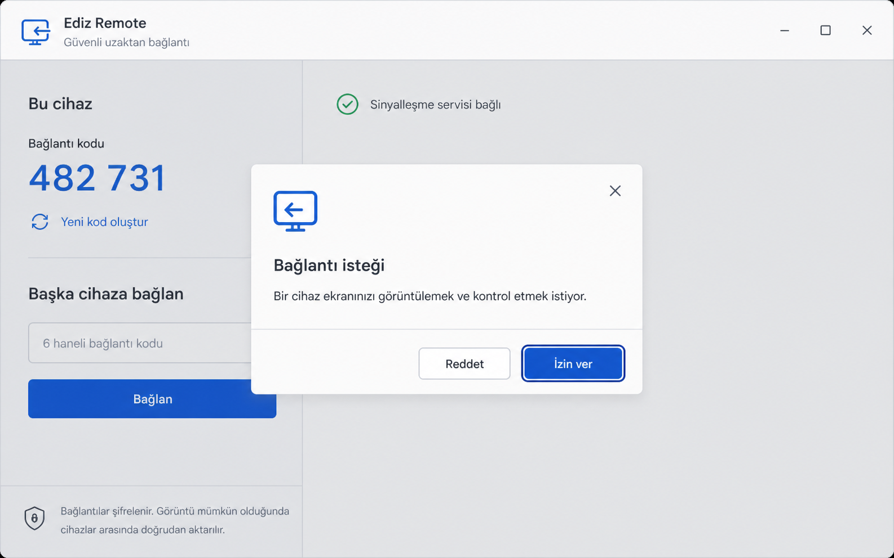
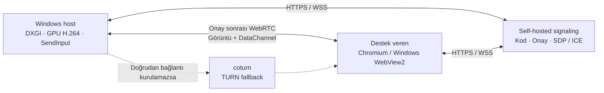

<p align="center">
  
</p>

<p align="center">
  <strong>Windows için P2P öncelikli, kendi sunucunda çalışan uzaktan destek.</strong><br>
  GPU destekli görüntü · Açık kullanıcı onayı · Türkçe arayüz
</p>

<p align="center">
  
  
  
  
  
</p>

<p align="center">
  <a href="#hızlı-başlangıç">Hızlı başlangıç</a> ·
  <a href="#nasıl-çalışır">Mimari</a> ·
  <a href="#yol-haritası">Yol haritası</a> ·
  <a href="docs/DEVELOPMENT.md">Teknik rehber</a> ·
  <a href="SECURITY.md">Güvenlik</a>
</p>

---

Ediz Remote, günlük müşteri desteği için geliştirilen Windows öncelikli bir
uzaktan erişim projesidir. Destek alan kişi uygulamayı açar, altı haneli kodunu
paylaşır ve gelen isteği onaylar. Destek veren kişi modern bir Chromium
tarayıcısından veya aynı Windows uygulamasından bağlanabilir.

Görüntü ve kontrol mümkün olduğunda cihazlar arasında doğrudan WebRTC ile akar.
Kendi sunucundaki signaling servisi kod, onay ve bağlantı görüşmesini yönetir;
doğrudan bağlantı kurulamazsa coturn devreye girer.

> **Geliştirme durumu:** Faz 1–3 tamamlandı; Faz 4 güvenlik sertleştirmesi sürüyor.
> İmzalı installer ve production Windows release kabulü henüz tamamlanmadı.
> Kaynak kod paylaşımı, hazır ve imzalı bir son kullanıcı sürümü anlamına gelmez.

## Neler sunuyor?

| | Özellik | Nasıl çalışıyor? |
|---|---|---|
| 🖥️ | GPU destekli masaüstü görüntüsü | DXGI yakalama, NV12 dönüşümü ve donanım H.264 encode |
| 🤝 | Kullanıcı onayı | 10 dakika geçerli tek kullanımlık kod; ayrı görüntüleme ve kontrol izni |
| 🖱️ | Fare ve klavye | Reliable giriş kanalı, düşük gecikmeli pointer ve güvenli input bırakma |
| 🌐 | P2P + TURN | Doğrudan bağlantı önceliği, kısa ömürlü HMAC credential ile relay fallback |
| 🔄 | Oturum kurtarma | 30 saniyelik grace period, reconnect ve kontrollü ICE yenileme |
| 🎛️ | Günlük destek araçları | Çoklu monitör, kalite profilleri, tam ekran, 1:1 ve sığdır |
| 🛑 | Görünür kontrol | Anında yetki iptali ve `Ctrl+Alt+Shift+F12` acil durdurma |
| 🏠 | Self-hosted altyapı | Raspberry Pi 5 / Linux, Docker Compose ve Cloudflare Tunnel |

Tarayıcı host fallback'i `getDisplayMedia` üzerinden yalnız görüntüleme sağlar.
Native fare ve klavye kontrolü Windows host uygulamasında uygulanır.

## Tasarım

Sade, Türkçe bir destek akışı: kodunu paylaş, isteği incele, izin ver.

<p align="center">
  
</p>

<details>
<summary><strong>Bağlantı onayı tasarımını göster</strong></summary>

<p align="center">
  
</p>

</details>

*Bu görseller arayüz tasarım konseptleridir; güncel uygulama ekran görüntüsü değildir.*

## Nasıl çalışır?



Cloudflare Tunnel web arayüzü ve signaling içindir. Masaüstü medyası P2P veya
TURN üzerinden taşınır. Host onayından önce SDP/ICE aktarımı, ekran yakalama ve
giriş enjeksiyonu başlamaz.

**Teknoloji:** React 19 · TypeScript · Vite · Express · WebSocket · Zod ·
.NET 8 · WPF · WebView2 · SIPSorcery · D3D11 · Media Foundation

## Hızlı başlangıç

Node.js 22+ LTS ve Git gerekir.

```bash
git clone https://github.com/EddizEge/ediz-remote.git
cd ediz-remote
npm ci
npm run dev
```

Arayüz: **http://localhost:8080** · Signaling: **http://localhost:8788**

Ekran paylaşımı için localhost veya HTTPS gerekir. Yerel tarayıcı denemesinde
iki istemci açıp kod ve onay akışını kullanabilirsin.

### Windows masaüstü

Windows üzerinde yardımcı betikler gerekirse .NET 8 SDK'yı yerel `.tools`
dizinine hazırlar.

```powershell
npm run desktop:test
npm run desktop:run
npm run desktop:publish
```

Yerel çıktı: `artifacts/windows-desktop/win-x64/EdizRemote.exe`.
İmzalama ve katalog doğrulaması için [Windows release rehberini](docs/WINDOWS_RELEASE.md) oku.

### Self-hosted kurulum

Pi/Linux üzerinde secret dosyalarını ve TURN adreslerini hazırladıktan sonra
production imajlarını tarayıp aynı denetlenmiş imajlarla dağıt:

```bash
npm run security:containers
npm run security:container:deploy
```

Tam kurulum: [geliştirme ve dağıtım rehberi](docs/DEVELOPMENT.md#raspberry-pi-5-kurulumu),
[TURN](docs/TURN.md) ve [container release kapısı](docs/CONTAINER_RELEASE.md).

## Doğrulama

```powershell
npm test
npm run lint
npm run build
npm run native:test
npm run desktop:test
npm run release:windows:test
npm run security:audit
```

Native capture ve GPU probe'ları Windows donanımı, gerçek relay testleri Docker
ve uygun ağ ortamı gerektirir. Son kaydedilen 2026-10-09 yerel tabanında
seed'li fuzz ve signaling durum makinesi matrisleri dahil 576 npm testi, 42 native
testi, 113 desktop testi ve 111 Windows release testi başarılıdır; npm/native
paketlerinde birer ortam testi atlanmıştır.
Bu sayılar tarihsel doğrulamadır; ayrıntılar [teknik rehberde](docs/DEVELOPMENT.md).

## Yol haritası

| Faz | Kapsam | Durum |
|---|---|---|
| 1 | Güvenli fare ve klavye kontrolü | ✅ Tamamlandı |
| 2 | İnternet bağlantısı ve oturum kurtarma | ✅ Tamamlandı |
| 3 | Uzaktan destek kullanıcı deneyimi | ✅ Tamamlandı |
| 4 | Güvenlik sertleştirmesi | 🛠️ Devam ediyor |
| 5 | İmzalı installer ve güncelleme | ⏳ Sırada |
| 6 | Soak testleri ve GPU/ağ matrisi | ⏳ Sırada |

Faz 4'te kalan başlıca kabul işleri: Pi `linux/arm64` gerçek scan/deploy kanıtı,
store/HSM sertifikalı EXE + katalog, RFC3161 timestamp ve temiz Windows 10/11
doğrulaması. Anti-rollback ve build provenance kapısı hazırdır; ilk imzalı yayın
temiz klondan artan release sequence ile üretilir. [Faz 4 planı →](docs/PHASE4_PLAN.md)

Ses, dosya aktarımı, clipboard ve gözetimsiz erişim V1 sonrası kapsamındadır.
UAC secure desktop, kilit ekranı, Session 0 ve `Ctrl+Alt+Del` sınırları aşılmaz.
Döndürülmüş ekran ve exact DXGI pointer shape desteği henüz tamamlanmadı.

## Belgeler ve katkı

| Belge | İçerik |
|---|---|
| [Geliştirme rehberi](docs/DEVELOPMENT.md) | Komutlar, deployment ve tarihsel doğrulama |
| [Protokol](docs/PROTOCOL.md) | Signaling, mesaj şemaları ve yetki sınırları |
| [Windows host](docs/WINDOWS_HOST.md) | Capture, encoder, RTP ve native WebRTC |
| [Windows desktop](docs/WINDOWS_DESKTOP.md) | WPF, WebView2 ve paketleme |
| [Tehdit modeli](docs/THREAT_MODEL.md) | Varlıklar, güven sınırları ve açık riskler |
| [Faz 4 kabul kanıtı](docs/PHASE4_ACCEPTANCE.md) | Kriter bazında kanıt, kanıt türü ve kalan engeller |
| [Audit modeli](docs/SECURITY_AUDIT.md) | Minimal olay şeması ve retention |
| [Katkı rehberi](CONTRIBUTING.md) | Hata bildirimi ve geliştirme yaklaşımı |
| [Güvenlik politikası](SECURITY.md) | Hassas bulguları özel bildirme |

Güvenlik dışındaki hata ve önerileri [Issues](https://github.com/EddizEge/ediz-remote/issues)
üzerinden paylaşabilirsin. Güvenlik bulguları için özel bildirim yolunu kullan.

**Lisans:** Henüz bir açık kaynak lisansı atanmadı. Repo görünürlüğü public olsa da
yeniden kullanım ve dağıtım koşulları için proje sahibinden izin alınmalıdır.
